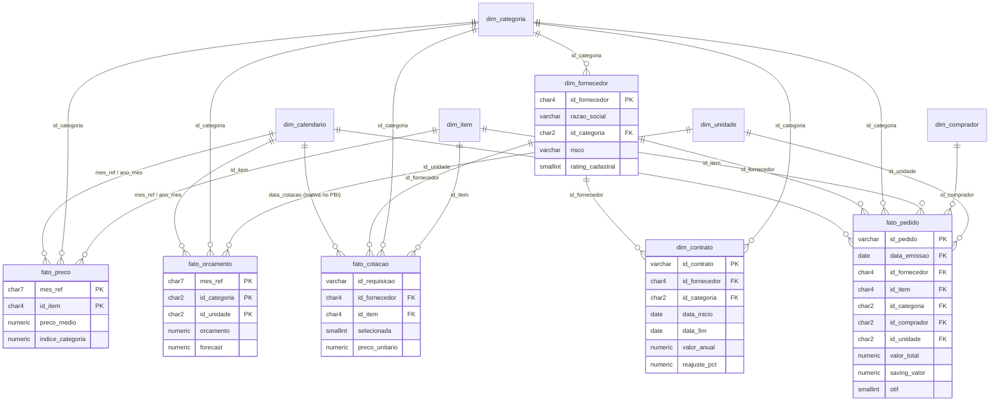

# Modelo de dados

## Diagrama estrela



> O diagrama é renderizado pelo GitHub (Mermaid). A versão vetorial para apresentações e
> documentação offline está em [`modelo-estrela.svg`](modelo-estrela.svg). O modelo Power BI
> é descrito em [`../powerbi/README.md`](../powerbi/README.md).

### Caminho do contrato

`dim_contrato` se relaciona com `dim_fornecedor` e `dim_categoria`. O fato de pedido não
tem `id_contrato`; a análise contratual usa **fornecedor + categoria + vigência** (veja
`vw_contrato_gestao` e `contractPortfolio`). Em produção, persistir a chave do contrato no
pedido elimina a ambiguidade quando há contratos sobrepostos.

## Grãos e chaves

| Tabela | Grão | Chave | Linhas |
| --- | --- | --- | ---: |
| `fato_pedido` | 1 pedido de compra por item/fornecedor/unidade | `id_pedido` | 3.120 |
| `fato_cotacao` | 1 proposta de fornecedor em uma requisição | `(id_requisicao, id_fornecedor, id_item)` | 11.416 |
| `fato_preco` | 1 item por competência | `(mes_ref, id_item)` | 1.190 |
| `fato_orcamento` | orçamento mensal por categoria/unidade | `(mes_ref, id_categoria, id_unidade)` | 736 |
| `dim_fornecedor` | 1 fornecedor | `id_fornecedor` | 123 |
| `dim_item` | 1 item de catálogo | `id_item` | 35 |
| `dim_categoria` | 1 categoria de compra | `id_categoria` | 8 |
| `dim_unidade` | 1 unidade de negócio | `id_unidade` | 3 |
| `dim_comprador` | 1 comprador | `id_comprador` | 8 |
| `dim_contrato` | 1 contrato | `id_contrato` | 40 |

**Por que cotações em fato separado?** O grão do pedido não guarda as propostas perdedoras.
Sem `fato_cotacao` não é possível medir spread, competitividade, aderência ao menor preço ou
quantas cotações foram realmente solicitadas — três dos indicadores centrais do projeto.

**Por que não há `dim_status`?** Status é atributo descritivo do pedido, com baixa
cardinalidade e sem hierarquia própria. Uma dimensão degenerada adicionaria um join sem
ganho analítico.

## Relacionamentos (Power BI)

| De | Para | Cardinalidade | Filtro | Observação |
| --- | --- | --- | --- | --- |
| `fato_pedido[data_emissao]` | `dim_calendario[data]` | N:1 | simples | relação ativa de data |
| `fato_pedido[id_fornecedor]` | `dim_fornecedor` | N:1 | simples | |
| `fato_pedido[id_item]` | `dim_item` | N:1 | simples | |
| `fato_pedido[id_categoria]` | `dim_categoria` | N:1 | simples | desnormalizada no fato por performance |
| `fato_pedido[id_unidade]` | `dim_unidade` | N:1 | simples | |
| `fato_pedido[id_comprador]` | `dim_comprador` | N:1 | simples | |
| `fato_cotacao[data_cotacao]` | `dim_calendario[data]` | N:1 | inativa | ativada em medidas de cotação |
| `fato_cotacao[id_fornecedor]` | `dim_fornecedor` | N:1 | simples | |
| `fato_preco[mes_ref]` | `dim_calendario[ano_mes]` | N:1 | simples | relacionamento por atributo |
| `fato_orcamento[mes_ref]` | `dim_calendario[ano_mes]` | N:1 | simples | |
| `dim_contrato[id_fornecedor]` | `dim_fornecedor` | N:1 | simples | |
| `dim_contrato[id_categoria]` | `dim_categoria` | N:1 | simples | análise contratual por categoria |

`id_categoria` aparece no fato **e** na dimensão de item. A duplicação é intencional: evita
um join extra em consultas de spend por categoria e permite categorizar compras de serviços
que não têm item de catálogo. A consistência é garantida por validação no ETL.

## Dicionário resumido de `fato_pedido`

| Coluna | Tipo | Regra / semântica |
| --- | --- | --- |
| `id_pedido` | texto | `PO-{ano}-{sequencial}` |
| `id_requisicao` | texto | liga o pedido às propostas em `fato_cotacao` |
| `data_emissao` | data | data do pedido; dirige o calendário |
| `mes_ref` | char(7) | competência `YYYY-MM` para joins e orçamento |
| `valor_unitario` | decimal | preço negociado (sem frete) |
| `valor_total` | decimal | quantidade × preço + frete |
| `preco_referencia` | decimal | baseline de mercado (catálogo/IPCA) |
| `saving_valor` | decimal | `(preco_referencia − valor_unitario) × quantidade`; **pode ser negativo** em sobrepreço |
| `tem_contrato` | booleano | cobertura contratual no momento do pedido |
| `data_entrega_prevista` | data | prazo acordado |
| `data_entrega_real` | data | nulo enquanto não entregue |
| `atraso_dias` | inteiro | `max(0, real − prevista)` |
| `qtd_recebida` / `qtd_defeito` | decimal | base para completude e taxa de defeito |
| `otif` | 0/1 | entregue no prazo, completo e sem defeito; coluna `GENERATED ALWAYS` no PostgreSQL |
| `status` | texto | Entregue, Em trânsito, Parcial, Atrasado, Cancelado |

## Histórico (SCD)

As dimensões são **tipo 1**: o cadastro reflete o estado atual. Para um projeto com
renegociação de rating e mudança de porte, o próximo passo seria SCD tipo 2 em
`dim_fornecedor` (versão, vigência, motivo), preservando a foto do fornecedor no momento do
pedido. O fato já carrega os atributos necessários para a análise histórica imediata
(preço, prazo, categoria), o que reduz o impacto dessa evolução.

## Nomenclatura

- `dim_` / `fato_` para objetos do modelo; prefixos `id_` para chaves; `_pct` para
  percentuais já multiplicados por 100 em views, fração 0–1 em DAX.
- Medidas DAX em português, sem prefixo de tabela, com espaços (legibilidade no relatório).
- Views SQL com prefixo `vw_` e nomes de negócio (`vw_fornecedor_scorecard`).

## Linhagem

```
fato_pedidos.csv ──► dw.fato_pedido ──► vw_spend_mensal ──► [Spend] (DAX) ──► cartão KPI
                                   └──► vw_fornecedor_scorecard ──► [Score Fornecedor]
fato_cotacoes.csv ─► dw.fato_cotacao ─► vw_requisicao_negociacao ─► [Spread Médio Cotação]
fato_orcamento.csv ► dw.fato_orcamento ─► vw_orcamento_aderencia ─► [Aderência Orçamento]
```
